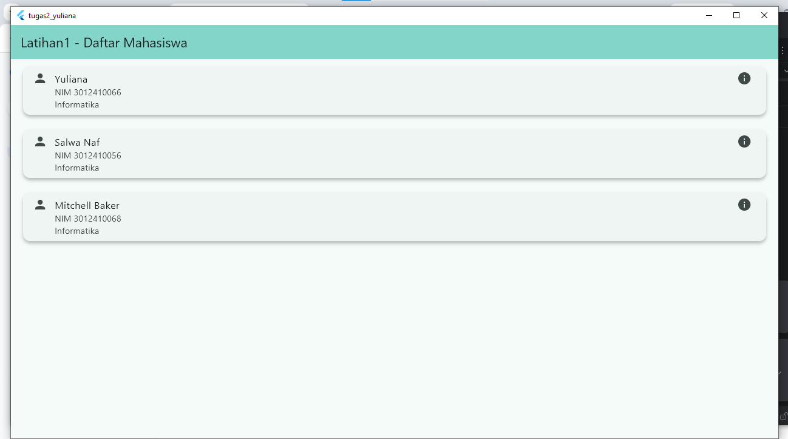
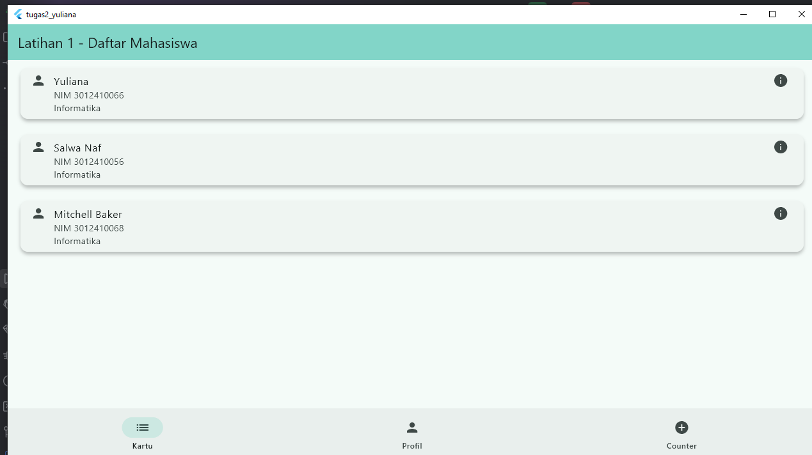
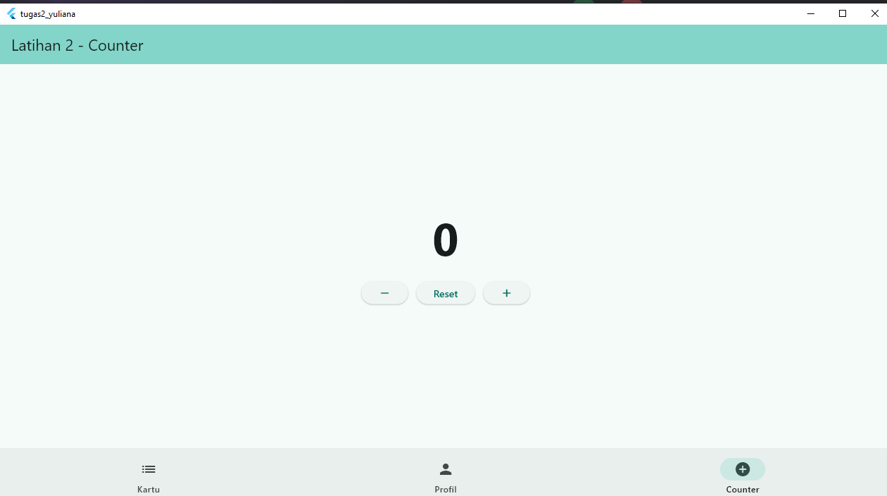
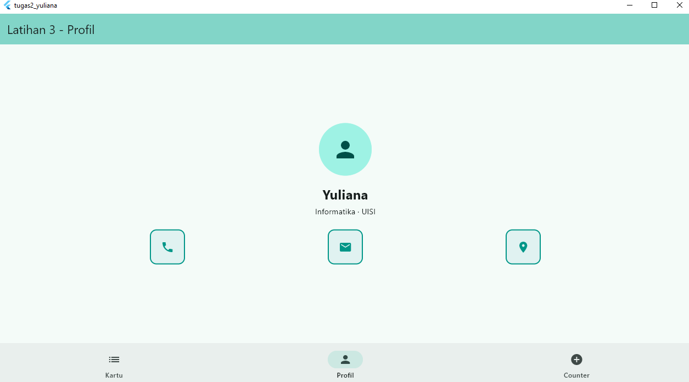

# Tugas 2 Pemrograman Mobile - Yuliana

Proyek ini dibuat untuk memenuhi Tugas 2 mata kuliah Pemrograman Mobile menggunakan Flutter.

## Output Aplikasi

Berikut adalah tampilan aplikasi saat dijalankan:

